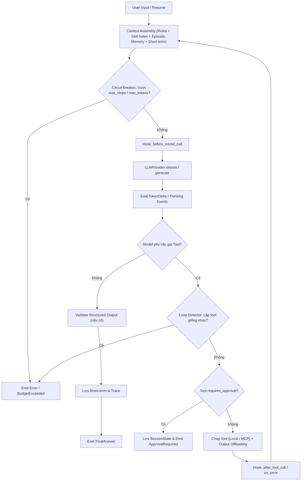

# 01. Tổng quan Kiến trúc (Architecture Overview)

## 1. Triết lý thiết kế cốt lõi

> *"Model là động cơ; Harness là khung xe, hệ thống lái, phanh và bảng điều khiển."*

1. **Hexagonal Architecture (Ports & Adapters):** Lõi `harness` chỉ giao tiếp qua các `Protocol` (Interface) và `Canonical Models` (Pydantic). Không phụ thuộc cứng vào SDK của bất kỳ hãng AI hay database nào.
2. **Thin Core (Lõi mỏng):** Tự chủ vòng lặp điều phối bằng Python thuần + `Pydantic v2`, tránh phụ thuộc các framework trừu tượng hóa nặng nề khó debug.
3. **Async-first & Event-driven:** Mọi thao tác I/O (gọi LLM, MCP, Tool, Memory) đều là `async def`, phát ra luồng sự kiện chuẩn để dùng chung cho CLI, FastAPI/WebSocket và UI.
4. **Config-driven & Eval-driven:** Hành vi hệ thống được điều khiển qua file YAML/ENV; mọi thay đổi Prompt/Skill/Model đều phải đo được bằng bộ `evals/`.

---

## 2. Cấu trúc thư mục Repo Template

```text
harness-ai/
├── pyproject.toml                  # Quản lý dependency chuẩn (khuyên dùng uv)
├── .env.example                    # Biến môi trường mẫu (API keys, DB URL...)
├── .agent/                         # Chuẩn Antigravity 2.0 (dùng chung cho IDE & Runtime)
│   ├── rules/                      # System instructions & guardrails (.md)
│   ├── skills/                     # Procedural skills (<name>/SKILL.md)
│   └── mcp_config.json             # Cấu hình MCP Servers
├── configs/
│   └── default.yaml                # Cấu hình LLM, budget, retry, memory, hooks
├── src/
│   ├── harness/                    # [LÕI BẤT BIẾN] Sẵn sàng tách thành Package
│   │   ├── core/
│   │   │   ├── agent.py            # Async AgentLoop & Event Streaming
│   │   │   ├── context.py          # Context Assembly, Compaction, Offloading
│   │   │   ├── state.py            # SessionState, Pause/Resume checkpoint
│   │   │   ├── models.py           # Canonical Models (Message, ToolCall, Event...)
│   │   │   ├── builder.py          # HarnessBuilder (lắp ghép từ config)
│   │   │   └── exceptions.py       # BudgetExceeded, LoopDetected, ApprovalRequired...
│   │   ├── providers/              # LLM Adapters (Gemini, OpenAI, LiteLLM...)
│   │   ├── tools/                  # @tool decorator, ToolRegistry, MCPBridge
│   │   ├── memory/                 # ShortTerm & LongTerm Memory interfaces/stores
│   │   ├── loaders/                # AgentsDirLoader (đọc .agent/ của Antigravity)
│   │   ├── guardrails/             # Circuit Breaker, PII filter, Structured Output repair
│   │   └── observability/          # Structured Logger, Trace JSONL (cho Replay)
│   └── app/                        # [NGHIỆP VỤ DỰ ÁN] Thay đổi theo từng bài toán
│       ├── tools/                  # Các @tool đặc thù của dự án
│       ├── schemas/                # Pydantic schemas cho đầu ra nghiệp vụ
│       └── main.py                 # Entrypoint (CLI / API)
├── evals/                          # Khung đánh giá chất lượng AI
│   ├── datasets/                   # Golden test cases (.jsonl)
│   ├── scorers.py                  # Exact match, Schema check, LLM-as-a-judge
│   └── run_eval.py                 # Runner chạy benchmark
├── docs/                           # Tài liệu thiết kế kiến trúc
└── tests/                          # Unit & integration tests (mock LLM)
```

---

## 3. Luồng thực thi của `AgentLoop` (Async + Event Stream)


